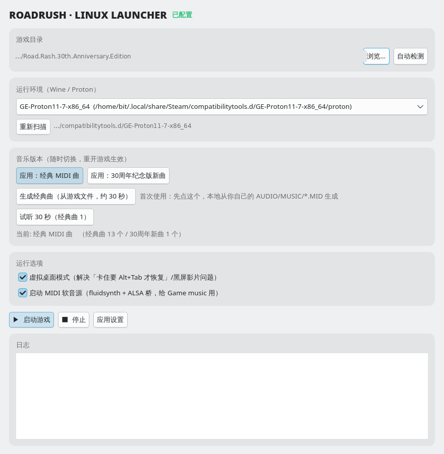

# ROADRUSH-LINUX-LAUNCHER

**Road Rash 30th Anniversary Edition 的 Linux 启动器 + 一套把"经典 MIDI 音乐"救回来的工具链。**



背景：这版 30 周年是重新编译的（PDB 路径里甚至带 `CLAUDE` 和 `BETA-2`），但引擎和音频一层没动——
还是 DirectDraw、还是 AWE32 硬件音源路线、还是 8-bit/22.05 kHz 的 `.RRA`。结果就是：

- 游戏运行后在 Wine 里只弹一个空 `Warning` 就退出（安装检测读注册表）
- 片头影片在 Wine 下要么崩（dxva2），要么黑屏静音（winegstreamer 解析失败）
- 全屏后时不时"卡住"，要 Alt+Tab 才恢复（XWayland + KWin 遮挡判定 + 影片独立窗口）
- **`Game music`（原版 MIDI）在没 AWE 卡的机器上永远没声音**

本项目把这些坑逐个填掉，并且把游戏里从未被播放的原始 MIDI 曲目（私有 `RIFF/MIDS` 格式）
解出来、渲染成音频、替换进游戏。

---

## 功能

### 启动器（GTK4）
- **首次运行向导**：扫描系统里的 Wine / Proton（`compatibilitytools.d`、`steamapps/common/Proton*`、`/opt/*`）→ 选一个"注册"为运行环境；游戏目录自动检测
- **音乐版本一键切换**：`应用：经典 MIDI 曲` ↔ `应用：30周年纪念版新曲`，实时显示槽位状态（如"经典曲 13 个 / 30周年新曲 1 个"）
- **运行选项**：虚拟桌面模式（治 Alt+Tab/遮挡）、MIDI 软音源（fluidsynth + ALSA 桥）
- **启动即修**：自动补安装检测注册表、灌 `dxva2=d`、隔离 fcitx、按 runner 决定 Proton/wine
- 日志面板实时显示

### 工具链（`tools/`）
| 工具 | 作用 |
|---|---|
| `mids2smf.py` | 私有 `RIFF/MIDS` → 标准 SMF（含块结构校验、尾部残块、块首标记的 delta） |
| `clean.py` | 修同音重复触发（补 off）、丢孤立 note-off、曲末补 off |
| `align.py` | 跨通道同音 note-on 对齐，消除三层叠加的 flam（听感上的"卡/咔"） |
| `retempo.py` | 时间轴缩放（绕开 fluidsynth 的 tempo 元事件 bug，保持音高） |
| `sf1_to_sf2.py` | SoundFont 1.0（`.SBK`）→ SF2（重建 phdr/shdr，处理 RIFF 奇数块） |
| `seq-connect.c` | ALSA sequencer 桥：把 Wine 的 MIDI 端口订阅到 fluidsynth |
| `music-mode.sh` | 原版/经典曲 两套配置切换（含备份与还原） |
| `play.sh` / `start-midi-synth.sh` | 不依赖 GUI 的启动 / 软音源拉起 |

## 安装与使用

```bash
# 依赖
sudo pacman -S python-gobject gtk4 fluidsynth soundfont-fluid   # Arch
# 可选：qsynth（GUI 试听）

# 启动器
python3 gui.py
./install.sh          # 装进应用菜单

# 命令行（不依赖 GUI）
python3 core.py --detect
GAME_DIR=/path/to/game tools/play.sh
GAME_DIR=/path/to/game SRC=~/Music/roadrash-95-official tools/music-mode.sh classic
```

配置文件：`~/.config/roadrush-launcher/config.json`

## 安装
**方式 1（推荐，不需要 AUR 账号）：本地编译成系统包**
```bash
git clone https://github.com/Fog-normal-passing-ftgplayer/Roadrush-30th-Linux-launcher.git
cd Roadrush-30th-Linux-launcher/packaging/aur
makepkg -si
```

免 root 用户级安装：`cd Roadrush-30th-Linux-launcher && ./install.sh`

### 经典 MIDI 音乐：一条命令搞定（不需要手动转换）
```bash
cd Roadrush-30th-Linux-launcher/tools
./make-classic-music.sh --game /path/to/Road.Rash.30th.Anniversary.Edition --install
```
它会在 ~30 秒内做完 MIDS 解码 → MIDI 清理/起音对齐 → 按各曲 BPM 渲染 → 响度归一 → 替换游戏
槽位（原版自动备份，菜单曲 `HB_TRIP` 保持原版）。产物在 `~/Music/roadrush-classic/`。

> **本仓库不包含任何音频文件**：音乐是从**你自己**的游戏文件现场生成的，理由见
> [DISCLAIMER.md](DISCLAIMER.md)。

## AUR（Arch Linux 一键安装）
```bash
yay -S roadrush-launcher-git      # 装好后应用菜单里直接启动
```
打包文件在 `packaging/aur/`（`PKGBUILD` + `.install` + `.SRCINFO`）。

## 目录结构
```
gui.py                  GTK4 界面（主窗口 + 首次运行向导）
core.py                 探测 / 配置 / 音乐切换 / 启动（也可当 CLI）
assets/roadrush.svg     图标
install.sh              桌面入口安装
tools/                  逆向与音频工具链（见上表）
docs/FORMATS.md         四种音频容器的逆向笔记（MIDS / SF1 / RRA / 影片）
docs/TROUBLESHOOTING.md 四个坑的原因与修法（安装检测 / dxva2 / Alt+Tab / MIDI 静音）
docs/MUSIC.md           BPM 表、渲染流水线、槽位映射
```

## 法律声明（详见 [DISCLAIMER.md](DISCLAIMER.md)）
本仓库**不包含任何游戏资源**（无 `.RRA`/`.MID`/`.SBK`/`.sf2`/渲染出的音频）。
工具只对用户自己合法持有的游戏文件做转换。Road Rash 及相关素材版权归 Electronic Arts；
转换产物请勿分发。

代码许可：MIT（见 LICENSE）。
